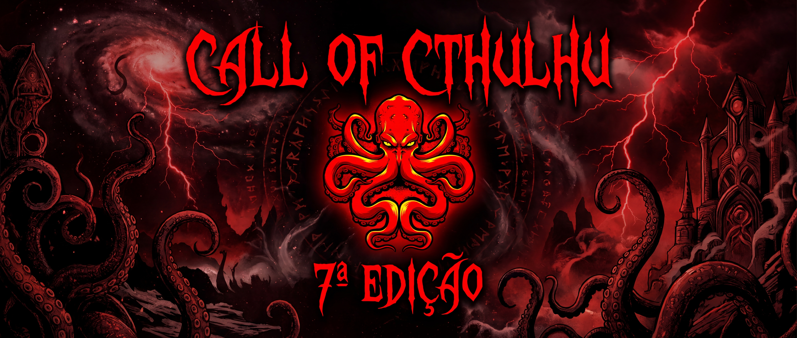
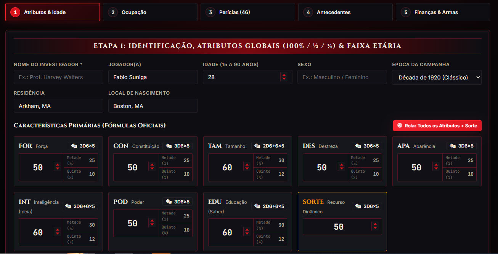
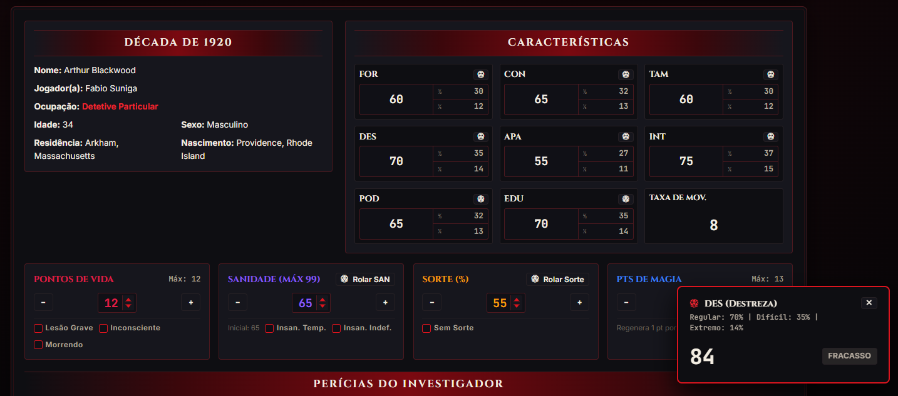
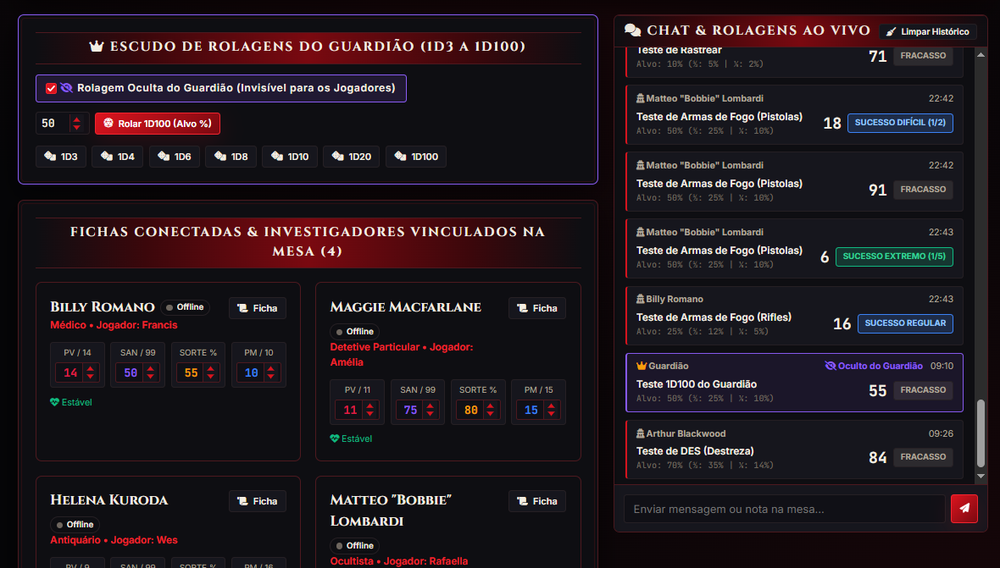

# Call of Cthulhu 7e — Criador & Arquivo de Investigadores

Plataforma web para criação guiada de investigadores, fichas interativas e gerenciamento de campanhas em tempo real, baseada nas regras oficiais da 7ª Edição de *Chamado de Cthulhu* (Chaosium Inc.).

  

---

<!-- BANNER TEMÁTICO DO TOPO -->

---

## Sumário

- [Visão Geral](#visão-geral)
- [Demonstração Visual](#demonstração-visual)
- [Principais Funcionalidades](#principais-funcionalidades)
- [Arquitetura e Tecnologias](#arquitetura-e-tecnologias)
- [Estrutura do Projeto](#estrutura-do-projeto)
- [Acesso Online](#acesso-online)
- [Aviso Legal (Chaosium Fan Policy)](#aviso-legal-chaosium-fan-policy)

---

## Visão Geral

*Chamado de Cthulhu 7ª Edição* é um dos sistemas de RPG de mesa mais aclamados do mundo, porém possui uma curva de entrada complexa na fase de criação de personagens: cálculos manuais de frações (metade e um quinto de valores), regras detalhadas de modificação por idade (penalidades em atributos físicos e melhorias em Educação), orçamentos restritos de pontos ocupacionais e gestão rigorosa de Sanidade e Sorte.

Este projeto foi construído para eliminar o atrito matemático e a burocracia de fichas em papel ou PDFs estáticos, permitindo que jogadores e Guardiões foquem no que realmente importa: a narrativa investigativa e o horror cósmico.

A aplicação foi validada em ambiente de jogo real, operando com sucesso uma sessão completa de jogo com zero suporte externo de calculadoras ou fichas físicas.

---

## Demonstração Visual

### 1. Wizard de Criação Guiada (5 Etapas)
*Fluxo passo a passo que calcula regras de idade, atributos, ocupações e interesses pessoais em tempo real.*

### 2. Ficha Interativa com Rolador 1D100 Integrado
*Ficha completa com frações pré-calculadas e avaliação instantânea de sucessos (Regular, Difícil, Extremo, Sucesso Crítico e Desastre).*

### 3. Gerenciamento de Mesas e Campanhas
*Espaço para o Guardião organizar a campanha e acompanhar os investigadores sincronizados.*

---

## Principais Funcionalidades

### Motor de Regras Oficial (`coc7eRules.js`)
- **Modificadores por Faixa Etária:** Implementação das tabelas de 15 a 90 anos, aplicando automaticamente penalidades em atributos físicos (FOR, CON, DES, TAM), checagens de melhoria de EDU e regra de Sorte vantajosa para jovens.
- **Cálculo Preciso de Frações:** Cálculo determinístico dos valores total, metade (1/2) e quinto (1/5) para todas as características e perícias.
- **Derivados Calculados:** Determinação automática de Pontos de Vida (PV), Pontos de Magia (PM), Limiar de Ferimento Grave, Taxa de Movimento (MOV), Bônus de Dano (BD), Corpo e Sanidade Inicial com base em POD.
- **Validação de Orçamento de Pontos:** Controle rigoroso dos pontos alocados em perícias ocupacionais (conforme a fórmula da ocupação) e pontos de interesses pessoais (INT × 2).

### Ficha de Investigador Dinâmica
- **Rolador de Dados Clicável:** Testes com 1 clique direto na perícia ou atributo, exibindo toast com margens de sucesso e resultado auditável.
- **Controle de Recursos em Jogo:** Ajuste rápido de Sanidade atual, Pontos de Vida, Magia e Sorte gastável.
- **Histórico e Conexões:** Campos estruturados para Ideologia/Crenças, Pessoas Importantes, Locais Significativos, Posses Queridas, Fobias, Manias e Encontros com o Mito.

### Mesas & Campanhas em Tempo Real
- **Painel do Guardião:** Criação e listagem de campanhas com associação direta de investigadores.
- **Sincronização de Estado:** Persistência centralizada em nuvem com sincronização via WebSockets.

---

## Arquitetura e Tecnologias

A aplicação foi desenvolvida seguindo o modelo de Single Page Application (SPA), priorizando leveza, tempo de carregamento imediato e facilidade de implantação em plataformas estáticas (como GitHub Pages, Vercel ou Netlify).

### Frontend
- **JavaScript Vanilla (ES Modules):** Código modular sem dependência de frameworks pesados, garantindo alta performance e manutenibilidade.
- **HTML5 Semântico & Acessibilidade:** Elementos com papéis acessíveis (`role`, `aria-live`) para retorno imediato aos leitores de tela em rolagens e notificações.
- **CSS3 Moderno:** Arquitetura baseada em variáveis CSS (Design Tokens), Flexbox e CSS Grid. Tipografia temática combinando *Cinzel*, *Inter* e *JetBrains Mono*.

### Backend & Nuvem
- **Supabase:**
  - **Supabase Auth:** Autenticação segura de usuários.
  - **PostgreSQL com Row Level Security (RLS):** Isolamento de dados garantindo que cada jogador acesse apenas seus próprios dados e campanhas autorizadas.
  - **Supabase Realtime:** Transmissão de eventos de campanha via WebSockets.

---

## Acesso Online

A aplicação está disponível e pronta para uso imediato via GitHub Pages, sem necessidade de download ou instalação local:

   
  
   
   

Basta acessar pelo navegador (desktop ou mobile), autenticar sua conta e começar a criar seus investigadores e campanhas.

---

## Aviso Legal (Chaosium Fan Policy)

Este é um projeto não oficial desenvolvido por fãs para a comunidade de RPG de mesa, para uso pessoal e educacional, sem qualquer finalidade comercial ou lucrativa.

*Call of Cthulhu* (Chamado de Cthulhu) e o logotipo de Call of Cthulhu são marcas registradas da **Chaosium Inc.** Todos os direitos sobre o universo, regras e elementos originais do sistema pertencem à Chaosium Inc. e aos seus respectivos autores.
