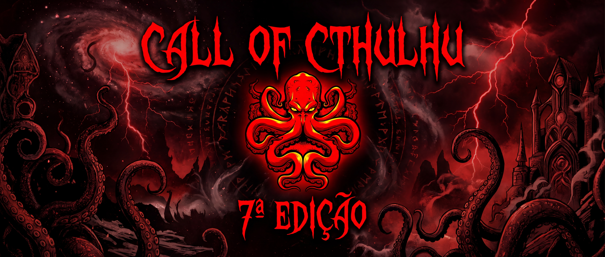
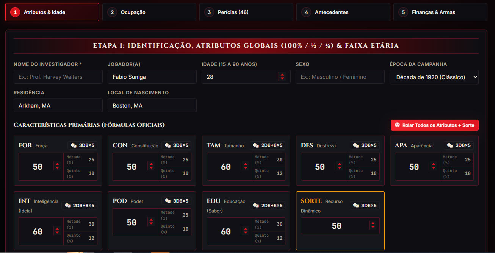
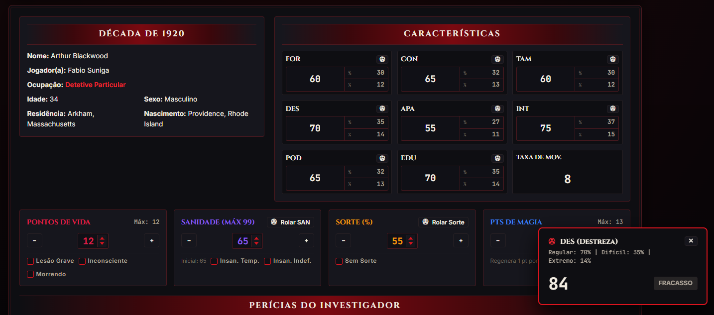
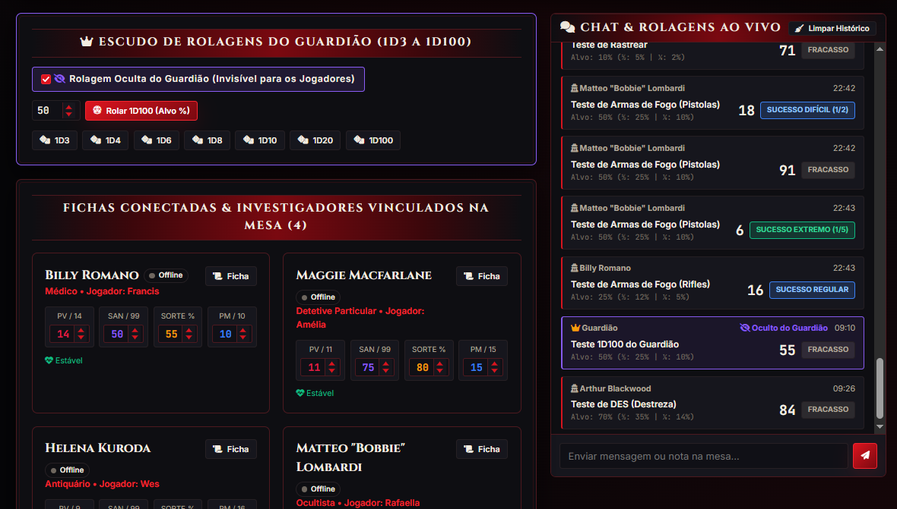

[Leia em Português](README.pt-BR.md)

# Call of Cthulhu 7e — Investigator Creator & Archive

Web platform for guided investigator creation, interactive character sheets, and real-time campaign management, based on the official 7th Edition rules of *Call of Cthulhu* (Chaosium Inc.).

  

---

<!-- TOP THEMATIC BANNER -->

---

## Table of Contents

- [Overview](#overview)
- [Visual Showcase](#visual-showcase)
- [Key Features](#key-features)
- [Architecture & Tech Stack](#architecture--tech-stack)
- [Online Access](#online-access)
- [Legal Notice (Chaosium Fan Policy)](#legal-notice-chaosium-fan-policy)

---

## Overview

*Call of Cthulhu 7th Edition* is one of the most acclaimed tabletop RPG systems in the world, yet it has a steep entry curve during character creation: manual fraction calculations (half and fifth values), detailed age modification rules (penalties to physical characteristics and Education improvement checks), strict occupational skill point budgets, and meticulous tracking of Sanity and Luck.

This project was built to eliminate mathematical friction and the overhead of paper sheets or static PDFs, allowing players and Keepers to focus on what truly matters: investigative storytelling and cosmic horror.

The application has been validated in a real tabletop environment, successfully running a full game session with zero external calculators or physical sheets.

---

## Visual Showcase

### 1. Guided Creation Wizard (5 Steps)
*Step-by-step flow that calculates age rules, characteristics, occupations, and personal interest points in real time.*

### 2. Interactive Sheet with Built-in 1D100 Roller
*Complete character sheet with pre-calculated fractions and instant success-level evaluation (Regular, Hard, Extreme, Critical Success, and Fumble).*

### 3. Table & Campaign Management
*Dedicated workspace for the Keeper to organize campaigns and monitor synchronized investigators.*

---

## Key Features

### Official Rules Engine (`coc7eRules.js`)
- **Age Modifiers:** Full implementation of the 15-to-90 age brackets, automatically applying penalties to physical characteristics (STR, CON, DEX, SIZ), EDU improvement checks, and the advantageous Luck roll rule for younger investigators.
- **Accurate Fraction Calculations:** Deterministic calculation of full, half (1/2), and fifth (1/5) values for all characteristics and skills.
- **Derived Attributes:** Automatic calculation of Hit Points (HP), Magic Points (MP), Major Wound Threshold, Move Rate (MOV), Damage Bonus (DB), Build, and Starting Sanity based on POW.
- **Point Budget Validation:** Strict tracking of points allocated to occupational skills (according to each occupation's formula) and personal interest points (INT × 2).

### Dynamic Investigator Sheet
- **Clickable Dice Roller:** One-click skill and characteristic rolls displaying toast notifications with success margins and auditable results.
- **In-Game Resource Tracking:** Quick adjustments for current Sanity, Hit Points, Magic Points, and spendable Luck.
- **Backstory & Connections:** Structured fields for Ideology/Beliefs, Significant People, Meaningful Locations, Treasured Possessions, Phobias, Manias, and Mythos Encounters.

### Real-Time Tables & Campaigns
- **Keeper's Dashboard:** Campaign creation and listing with direct investigator association.
- **State Synchronization:** Centralized cloud persistence with real-time updates via WebSockets.

---

## Architecture & Tech Stack

The application was designed as a Single Page Application (SPA), prioritizing lightweight performance, instant load times, and straightforward deployment on static hosting platforms (such as GitHub Pages, Vercel, or Netlify).

### Frontend
- **Vanilla JavaScript (ES Modules):** Modular codebase with zero heavy framework dependencies, ensuring high performance and maintainability.
- **Semantic HTML5 & Accessibility:** Accessible roles and live regions (`role`, `aria-live`) for immediate screen-reader feedback on dice rolls and notifications.
- **Modern CSS3:** Built with CSS Custom Properties (Design Tokens), Flexbox, and CSS Grid. Thematic typography pairing *Cinzel*, *Inter*, and *JetBrains Mono*.

### Backend & Cloud
- **Supabase:**
  - **Supabase Auth:** Secure user authentication.
  - **PostgreSQL with Row Level Security (RLS):** Data isolation ensuring each player can only access their own records and authorized campaigns.
  - **Supabase Realtime:** Live campaign event broadcasting via WebSockets.

---

## Online Access

The application is live and ready to use via GitHub Pages, with no download or local installation required:

   
  <a href="

   
  
   
   

Simply open it in your browser (desktop or mobile), sign in, and start creating investigators and campaigns.

---

## Legal Notice (Chaosium Fan Policy)

This is an unofficial fan-made project created for the tabletop RPG community for personal and educational use, with no commercial or for-profit purpose.

*Call of Cthulhu* and the Call of Cthulhu logo are registered trademarks of **Chaosium Inc.** All rights to the universe, rules, and original elements of the system belong to Chaosium Inc. and their respective authors.
